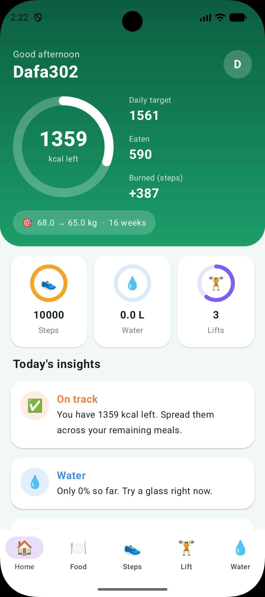
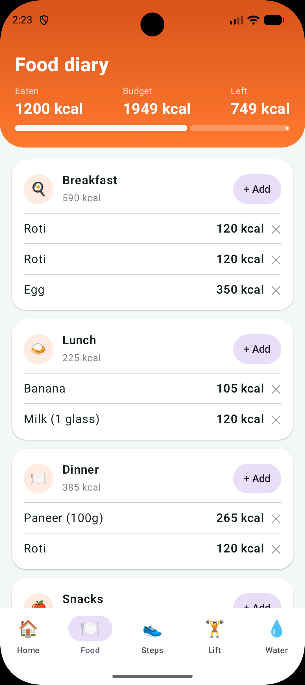
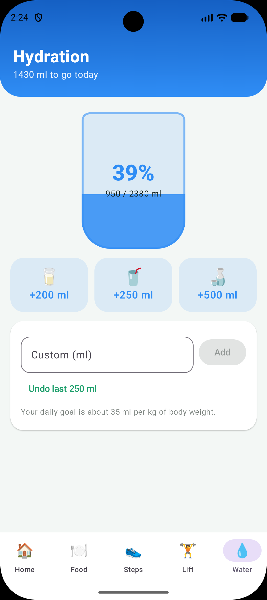

# FitTrack: Android Fitness App

A fitness tracker built with **Kotlin** and **Jetpack Compose (Material 3)**. Set a weight goal and a timeline, and FitTrack builds a daily calorie target, then helps you track food, steps, strength workouts and water through the day.

<!-- Replace these with your own screenshots (see "Screenshots" below) -->
<p align="center">
  
  
  
</p>

## Features

- **Login and sign-up:** local account with a SHA-256 hashed password, stored on the device only
- **Goal setup:** enter current weight, goal weight and number of weeks. A live summary shows weekly pace, daily calories and water goal, with a warning if the pace is too aggressive
- **Home dashboard:** animated calorie ring (kcal left), quick tiles for steps, water and lifts, and daily insights
- **Calorie tracker:** meal-based food diary (breakfast, lunch, dinner, snacks) with quick-pick foods
- **Step counter (manual entry):** enter your steps and get estimated calories burned, distance and active minutes
- **Strength workout tracker:** log exercises with sets, reps and weight, with total volume per session
- **Water tracker:** animated glass, quick-add buttons, custom amounts and undo
- **Daily insights and tips:** advice based on your calories, water, steps and workouts, plus a rotating daily tip
- **Light and dark mode**

## Tech stack

| Area | Details |
|---|---|
| Language | Kotlin |
| UI | Jetpack Compose, Material 3 |
| State | Compose state (`mutableStateOf`, `mutableStateListOf`) in a `FitStore` state holder |
| Storage | SharedPreferences (on-device) |
| Graphics | Compose `Canvas` for the progress rings, animated with `animateFloatAsState` |

## How the numbers work

These are rough estimates and **not medical advice**.

- **Daily calorie target** = body weight (kg) × 26, plus or minus the daily deficit or surplus needed to reach your goal in the chosen time (7,700 kcal per kg of body weight). The deficit is capped at 1,000 kcal/day, and the target never drops below 1,200 kcal.
- **Calories from steps** ≈ steps × body weight × 0.00057 (about 0.04 kcal per step at 70 kg). These are added to the day's budget.
- **Water goal** = 35 ml per kg of body weight, with a minimum of 1,500 ml.

## Getting started

1. Clone the repo:
   ```bash
   git clone https://github.com/<your-username>/<your-repo>.git
   ```
2. Open the project in **Android Studio** and let Gradle sync.
3. Pick an emulator or a connected device and press **Run**.

Requires a recent Android Studio. If Gradle reports a `compileSdk` error, update `compileSdk` in `app/build.gradle.kts` to the version it asks for.

## Screenshots

Add your images to a `screenshots/` folder in the repo root: `home.png`, `food.png`, `water.png`. In the emulator toolbar, the camera icon takes a screenshot.

## Known limitations

- Data is stored for the current day only, with no history yet
- Steps are entered manually and are not read from a phone sensor
- Accounts are local to the device, with no cloud sync

## Roadmap

- [ ] Room database with history and a weight-over-time chart
- [ ] ViewModel architecture and splitting the code into separate files
- [ ] Automatic step counting with the device step sensor
- [ ] Unit tests for the calorie calculations
- [ ] Reminders for water and meals

## License

MIT. See `LICENSE` if you add one.